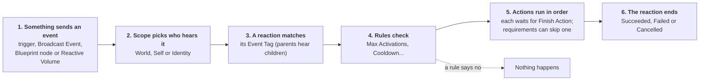

# Core Concepts

Everything in Reactive Actors follows one pattern: **something sends an event, and anything listening reacts**. This page explains each piece in that pattern, in the order an event meets them.

One event can start reactions on many actors at once; each one runs its own actions.

## Events

An **event** is a Gameplay Tag that means "this just happened", such as `Event.Door.Open` or `Event.Lights.Off`. Events carry no data of their own. They're just names.

Tags are matched **parent to child**. A reaction listening for `Event.Door` hears `Event.Door.Open` and `Event.Door.Locked` too. This lets you listen broadly or narrowly.

You send an event in one of four ways:

- A **trigger** on an actor sends it automatically (when the level starts, on a timer...).
- A **Broadcast Event** action sends it as one step of another reaction, to chain reactions together.
- Any Blueprint sends it with the **Broadcast Event** node.
- A **Reactive Volume** (from **Place Actors > Reactive**) sends it when something walks in or out.

## Scope: who hears an event

When you send an event, you choose its **scope**:

| Scope | Who hears it | Use it for |
| --- | --- | --- |
| **World** | Every actor listening for that event | "The power went out": everything reacts |
| **Self** | Only the actor that sent it | An actor talking to itself, e.g. a timer on a lamp telling the same lamp to flicker |
| **Identity** | Every actor with a given identity tag | "All the kitchen lights": actors tagged `Actor.Kitchen` |

World is the default. Use Self and Identity when you want to be specific, so Reactions sharing an Event name don't all fire at once.

## Identities

An **identity** is a name tag you give an actor in its Reaction Component's **Identity Tags**, such as `Actor.Kitchen.Lamp`. Identities let you talk to actors without picking them one by one: send to `Actor.Kitchen` and every actor whose identity is `Actor.Kitchen` or a child of it (like `Actor.Kitchen.Lamp`) hears it.

Identities are also used by **Run On Targets** (do these actions to every actor with an identity) and the **Has Identity** requirement.

### Pointing at one particular actor

There's no slot to drag a specific actor from the level into. Instead, **give that actor its own identity**, and send to it:

1. On the door's Reaction Component, add the identity `Actor.Kitchen.BackDoor`.
2. Wherever the key is picked up, send `Event.Door.Unlock` with **Event Scope** set to **Identity** and **Target Identity** set to `Actor.Kitchen.BackDoor`.

Only that door hears it. This is the normal way to make *this* thing react to *that* thing. It also keeps working if the door is moved, renamed, or swapped for a different Blueprint, because nothing points at the actor itself.

:::tip

Name identities by where things are and what they are, such as `Actor.Kitchen.BackDoor` or `Actor.Attic.Lamp`. Then `Actor.Kitchen` reaches everything in the kitchen for free.

:::

## Reaction Component

The **Reaction Component** is what makes an actor reactive. You can add it to any actor, placed in the level or in a Blueprint. It holds:

- **Identity Tags**: this actor's names (above).
- **Preset**: an optional Reaction Preset to share reactions with other actors (below).
- **Reactions**: Per-instance what this actor does when it hears events.
- **Triggers**: Per-instance what this actor watches for, to send events.

## Reactions

A **reaction** says: *when this event arrives, run these actions*. Each reaction has:

- **Event Tag**: the event it listens for.
- **Actions**: what to do, in order, top to bottom.
- **Rules**: limits such as *only once* or *not more than every 5 seconds*. Affects the whole reaction, not each rule.
- **Retrigger**: what happens if the event arrives again while the actions are still running. **Ignore** (the default) lets the current run finish and ignores the new event. **Restart** stops the current run and starts again from the top.
- **Enabled**: switch a reaction off without deleting it.

## Actions

An **action** is one thing done to one actor: play a sound, hide an actor, wait two seconds, send another event. A reaction's actions run **one after another**, and each waits for the one before it to finish. That's why a **Delay** in the middle of a list works the way you'd expect.

By default an action acts on the actor that owns the reaction. That actor is called the **target**.

Generally, actions should only try and do one thing. If you want to do multiple things, you are better off setting up multiple actions and triggering them in sequence.

:::note

Every action tells the reaction when it's done by calling **Finish Action**. The built-in actions do this for you. When you make your own, you must call it too. See [Making Your Own](./making-your-own.md).

:::

### Success and failure

An action can finish as a **success** (the normal case) or a **failure**. A failure stops the reaction: the actions after it don't run, and the reaction ends as **Failed**. A reaction can end three ways:

- **Succeeded**: every action ran.
- **Failed**: an action failed, or a **Stop Reaction** action ended it as a failure.
- **Cancelled**: something deliberately stopped it, such as a Restart, Cancel Reactions, or the actor being destroyed.

## Requirements

A **requirement** is a yes/no check: *is the instigator the player?* *does the target have this tag?* Requirements appear in three places:

- On an **action**: if a requirement fails, that action is **skipped** and the reaction carries on with the next one. Tick Stop Reaction If Not Met on the action to stop the whole reaction there instead (it ends as Failed). Built-in requirements of an action's class are under **Requirements**; ones you add to a single action are under **Extra Requirements**.
- On a **Branch** action, as its **Conditions**: they decide which list of actions runs.
- On a **trigger**, as its **Conditions**: they decide whether it fires.

Every requirement has a **Not** tick box that flips it: *Not Is Class: BP_Door* passes for anything that isn't a door.

Most built-in requirements also have a **Check** setting: test the **Target** (the actor being acted on) or the **Instigator** (whoever caused the event).

## Rules

A **rule** is a limit with **memory**, and/or something extra that should happen every time the reaction runs. Requirements look at the moment; rules remember the past. The built-in rules are **Max Activations** (eg. reaction can happen *only once*) and **Cooldown** (can't fire *again for 5 seconds*).

Rules sit on reactions and on triggers. If any rule says no, the reaction doesn't start or the trigger doesn't fire. Each actor's reaction keeps its own count, so a *Max Activations = 1* on a Preset means once **per actor**, not once in the whole game.

For *once in the whole game*, or anything else shared between actors ("the third time", "all three notes read"), keep the count in your own game's system, such as a fact database, and check it with your own Blueprint requirement. See the [FAQ](./faq.md#only-once-happens-once-per-lamp-not-once-in-total).

### Checks at a glance

There are a few kinds of check, and they live in different places. Use this table when you're not sure where one goes:

| Where | Name in the Details panel | What it asks | If it says no |
| --- | --- | --- | --- |
| On an action, built into its class | **Requirements** | "Can this action run right now?" | That action is skipped; the reaction carries on. With **Stop Reaction If Not Met**: the reaction stops (Failed) |
| On one action you've placed | **Extra Requirements** | Same, for this one action only | That action is skipped; the reaction carries on. With **Stop Reaction If Not Met**: the reaction stops (Failed) |
| On a Branch action | **Conditions** | "Which list of actions runs?" | The False Actions run instead |
| On a trigger | **Conditions** | "Should this trigger fire right now?" | The trigger doesn't fire |
| On a reaction or trigger | **Rules** | "Has this already happened too often, or too recently?" | The whole reaction (or fire) doesn't happen |

Requirements and Conditions are the same kind of thing (a requirement), just used in different places. Every one of them has **Not** to flip it and, for the built-in ones, **Check** to test the Target or the Instigator. Rules are the only checks that remember the past.

## Triggers

A **trigger** watches for something and sends an event when it happens. The built-in triggers are **Begin Play**, **End Play**, **Timer** and **Event Received** (send an event when you hear another one).

When a trigger fires, its **Rules** are checked first, then its **Conditions**. If all pass, it sends its **Event**.

## Context: target, instigator, event

Every run carries a small bundle of information called the **context**:

- **Target**: the actor the actions act on. Usually the actor that owns the reaction.
- **Instigator**: who caused it, such as the player who opened the door. It can be empty.
- **Event**: the event that started the run.

Actions and requirements read the context if needed. That's how *Is the instigator the player?* knows who to check.

### Who's the instigator when nothing caused it?

When a trigger fires on its own (**Begin Play**, **End Play**, **Timer**), the **instigator is the trigger's own actor**. So a requirement with **Check** set to **Instigator** tests the actor itself, not the player. **Event Received** passes on the instigator of the event it heard. If you need the player in those cases, check the Target or use a Branch, rather than relying on the Instigator.

A **Reactive Volume** uses the actor that walked in as the instigator.

## Reaction Presets

A **Reaction Preset** is an asset that holds reactions and triggers, so many actors can share them. Make one with **Content Browser → right-click → Reactive → Reaction Preset**, fill it in, then set it as the **Preset** on each actor's Reaction Component.

Each actor gets its **own copy** when play starts, so rules count per actor. An actor can have a Preset **and** its own reactions: the Preset's run first, then its own.

## Reactive Volume

Some logic belongs to an area of the level rather than a prop. For that, drag a **Reactive Volume** in from **Place Actors > Reactive**. It's a box, invisible in game, that sends an event when an actor walks in or out. The **In Volume** requirement can check whether an actor is inside one. It needs no Reaction Component. The [Built-in Reference](./built-in-reference.md#placeable-actors) lists its settings.
