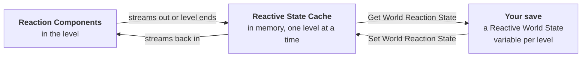

# Save and Load

Reactive Actors remembers what its reactions have done in each level, and hands that to your game as **one value per level** to put in your save. It never writes save files itself, so it works with whatever save system you already use: Unreal's own Save Game, SPUD, Easy Multi Save, or your own.

If your game doesn't save, you don't need to do anything. Nothing is saved unless you call the nodes on this page.

## What gets remembered

| Remembered | Not remembered |
| --- | --- |
| Each reaction's **Enabled** (switched off with Set Reaction Enabled) | A reaction part-way through running. After a load it's simply gone: nothing restarts |
| **Max Activations** counts | Where actors are, whether they're hidden, or whether they've been destroyed. That's your save system's job |
| **Cooldown** time left | Requirements. They only check the moment, so there's nothing to keep |
| **Random Action**'s last pick (for Avoid Repeat) | Actors spawned while playing. See [Spawned actors](#spawned-actors) |
| Any variable with **SaveGame** ticked in your own rules, triggers and actions | Variables in your own blocks without SaveGame ticked |

Only actors where something actually happened are included. A level with 500 reactive props, three of which have fired, saves three small entries.

:::note

Because Reactive Actors never saves positions, visibility or destroyed actors, it can't fight with your save system over them. If your save system restores a door as open, Reactive Actors restores the door's *reactions*: for example, that its "open once" reaction has already been used.

:::

## How it works

While you play, each Reaction Component keeps its own state. When part of the level streams out, its components hand their state to the **Reactive State Cache** (a Game Instance subsystem), and take it back when they stream in again. So streaming and World Partition just work, with or without a save system.

When your game saves, **Get World Reaction State** gives you everything the cache knows about the current level, including parts that have streamed out, as one **Reactive World State** value. When your game loads, **Set World Reaction State** hands it back.

## The nodes

| Node | Use it to |
| --- | --- |
| **Get World Reaction State** | Get the current level's state, to put in your save |
| **Set World Reaction State** | Hand a saved state back, before **Open Level** or after the level has loaded |
| **Clear World Reaction State** | Forget everything the cache holds (New Game, chapter reset) |
| **Hold Reactions Until Restored** | Only if your save arrives a few frames after the level starts: nothing fires until Set World Reaction State |
| **Release Held Reactions** | Let go of a hold if the load failed and no state is coming |
| **On World Reaction State Expiring** | An event on the Reactive State Cache: the level is ending, so store the state it gives you if you'll come back |
| **Capture Reaction State** / **Restore Reaction State** | On one Reaction Component, for actors you spawn yourself |

All of them are under **Reactive Actors > Save** in the Blueprint menu. To bind **On World Reaction State Expiring**, use **Get Reactive State Cache**, then drag off it and search for the event.

## Set it up: one level

The simplest case is a game set in a single level (or one persistent level with streaming), saved with Unreal's own **Save Game** object.

**Saving**

1. Open your Save Game Blueprint and add a variable of type **Reactive World State**. Call it `ReactionState`.
2. Where you save the game, call **Get World Reaction State** and set `ReactionState` from it, then save as usual (**Save Game to Slot**).

**Loading**

1. In your Game Mode's **Begin Play**, load your Save Game (**Load Game from Slot**).
2. Call **Set World Reaction State** with its `ReactionState`.

That's all. Unreal's Save Game loads straight away, so the state is back before any trigger fires.

## Set it up: several levels

When the player travels between levels and can come back, each level has its own state, and the cache only ever holds the level you're in. So keep one per level:

1. In your save, use an **array** of **Reactive World State** instead of a single one. Each entry knows which level it belongs to: its **World Key** (the map name).
2. **Before leaving a level**: get the Reactive State Cache, bind **On World Reaction State Expiring**, and in it, store the state it gives you. Replace the entry with the same World Key if there is one, otherwise add it. This fires as the level ends, after every actor has handed its state over.
3. **When saving**, also do the same with **Get World Reaction State**, for the level you're in.
4. **When loading**, find the entry whose World Key is the level being loaded, and hand it back with **Set World Reaction State** (see below).

Bind the event once, somewhere that lasts across levels, such as your Game Instance's **Init** event. Arrays of structs work in every save system.

:::tip

Going back to a level the player has already left? Call **Set World Reaction State** with that level's entry before **Open Level**, the same as loading a save. Otherwise the level starts fresh.

:::

## Loading: when to call Set World Reaction State

The one thing to get right is timing. **Begin Play** triggers fire on the first frame of the level, so the saved counts must be back by then, or a "only once" scare could play again.

There are two safe ways:

- **Before Open Level.** Load your save, call **Set World Reaction State**, then call **Open Level**. The state waits for that level, and each actor gets its share as it begins play, before any trigger fires.
- **After the level loads.** In the Game Mode's **Begin Play**, call **Set World Reaction State** straight away. Begin Play triggers wait for the next frame, so they still see the restored state.

If your save system finishes loading a few frames *after* the level starts (some load in the background), call **Hold Reactions Until Restored** in the Game Mode's Begin Play instead, and **Set World Reaction State** once your save has loaded. While held, triggers and Reactive Volumes keep what they would have fired, then fire it once the state is back.

:::warning

Only hold when you're actually loading a save. If you hold on a new game, nothing fires until the hold lets go by itself: after **Hold Safety Release** seconds (10 by default, in Project Settings > Plugins > Reactive Actors > Save and Load), with a warning. If a load fails part way, call **Release Held Reactions**.

:::

Setting a state on a level that's already playing (loading a save from the pause menu, say) works too: running reactions on loaded actors are cancelled, then their saved state is applied. Actors that haven't streamed in yet get theirs when they do.

## Using other save systems

Reactive World State is plain data (names, tags, IDs, numbers and bytes), so any save system that can save a struct can carry it. The pattern is the same everywhere: keep the value (or the array of them) in a variable your save system already saves, fill it just before saving, and hand it back after loading.

- **SPUD:** add the variable, with **SaveGame** ticked, to an object SPUD saves globally, such as your Game Instance. Fill it from SPUD's pre-store callback, and call Set World Reaction State from its post-restore callback.
- **Easy Multi Save:** add the variable, with **SaveGame** ticked, to an actor or object it saves. Fill it in the pre-save event, and call Set World Reaction State after loading.
- **Your own system:** however it saves a struct. Call Get World Reaction State just before writing, and Set World Reaction State after reading.

If the restore happens a few frames after the level begins, add **Hold Reactions Until Restored** as described above.

## Starting fresh: New Game and checkpoints

- **New Game:** call **Clear World Reaction State** so nothing from an earlier playthrough comes back, then **Reset All Reactions** to reset actors that are already loaded.
- **Restarting a chapter or checkpoint** without loading a save: **Reset All Reactions** puts every loaded reaction back as if it had never fired. There are versions for one actor, one identity and one event.

## Streaming and World Partition

Nothing to set up. Actors in streamed sublevels and World Partition cells hand their state to the cache as they stream out, and get it back when they stream in, so a "once only" reaction stays used when the player walks away and comes back.

If you'd rather streamed-in actors start fresh every time, untick **Keep State When Streamed Out** in **Project Settings > Plugins > Reactive Actors > Save and Load**.

## Spawned actors

Only actors **placed in a level** (including streamed sublevels and World Partition cells) are kept in Reactive World State. Actors spawned while playing aren't, because they come back with a different name after loading, so their saved state couldn't find them.

To keep a spawned actor's reactions, save them with the actor, using whatever re-spawns it:

1. Give the actor a **Reactive Actor State** variable with **SaveGame** ticked.
2. Before saving (SPUD's pre-store callback, Easy Multi Save's pre-save event, or your own save code), set it from **Capture Reaction State** on its Reaction Component.
3. When it's spawned again, call **Restore Reaction State** with it in the actor's **Begin Play**.

:::note

This may change in a later version (for example, a Save ID you give spawned actors). We'll update this section if it does.

:::

## Your own rules, triggers and actions

To make your own block remember something across saves, tick **SaveGame** on that variable (in the variable's details, under **Advanced**). It's then saved and loaded with everything else. Nothing else is needed.

| Tick SaveGame on | Don't (Data Validation warns) |
| --- | --- |
| Counts, true/false flags, enums, names, Gameplay Tags | Actor or component references: save the actor's **Identity Tag** instead, and find it again with Get Actors By Identity |
| Durations and "seconds left" | Timer Handles: let the timer start again after loading, or use the built-in **Cooldown** rule |

SaveGame on a requirement does nothing, because requirements are never saved, and Data Validation flags that too.

For C++ blocks, override `PreSaveState` and `PostLoadState` when a value can't be saved as it is. The built-in Cooldown does this: it stores "seconds left" instead of a world time, because world time starts again after loading.

## Keeping saves working as the game changes

Old saves keep loading as you work on the game:

- **Reordering reactions or triggers** is safe. Each one carries a hidden ID, given in the editor, so its saved state finds it wherever it moves.
- **Removing** a reaction, rule, trigger or action skips its saved state. Adding new ones gives them fresh state.
- **Renaming or moving** a Blueprint or C++ class is followed through Unreal's redirectors.
- **Engine upgrades**: saved state records the engine version that wrote it and is read back the same way.
- **Renaming a level** changes its World Key, so saves made before the rename won't find it.

## Troubleshooting

**A Begin Play reaction plays again after loading.** The state arrived after the trigger fired. Call Set World Reaction State before Open Level or in the Game Mode's Begin Play, or use Hold Reactions Until Restored if your save loads later than that.

**Nothing fires for a few seconds after starting a new game, then a warning appears.** Hold Reactions Until Restored was called but no state came. Only call it when loading a save.

**Counts reset after travelling back to a level.** Its state wasn't stored when you left. Bind On World Reaction State Expiring and keep each level's state under its World Key, then hand it back before Open Level.

**A spawned actor forgets its reactions.** Spawned actors aren't in Reactive World State. Use Capture Reaction State and Restore Reaction State, as described in [Spawned actors](#spawned-actors).

**A reaction half-way through a Wait For Event is gone after loading.** That's by design: running reactions aren't saved. Keep progress in data instead. See [Multi-step goals](./guides.md#multi-step-goals-quests) in Guides.
